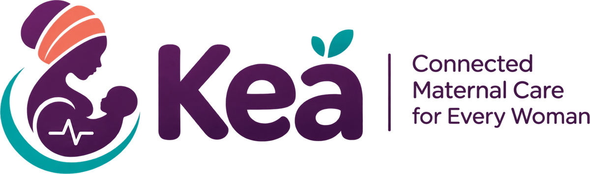

<p align="center">
  
</p>

<p align="center">
  <strong>Connected maternal care for every woman.</strong><br>
  Referral tracking and continuity of care for maternal health services.
</p>

<p align="center">
  <a href="LICENSE"></a>
  
</p>

---

## What Kea is

In many health systems a pregnant woman can be referred from a clinic to a
hospital without reliable confirmation that she arrived, was seen or came back
for follow-up. Paper registers, separate systems and phone calls leave the
referring clinician without an answer, and leave managers unable to see where
in the pathway cases are being lost.

Kea holds the referral as one record with an explicit state, shared by the
referring facility, the receiving facility and the patient. Every change is
attributed, timestamped and permanent. When a step does not happen, a
coordination task is raised for a named person rather than the gap going
unnoticed.

**What Kea is not.** It is not a medical device, it does not give clinical
advice, it does not triage, and it must not be relied on for emergency
response. Clinical decisions remain with qualified healthcare professionals.

## What is in this repository

| Area | Where |
| --- | --- |
| Public website | `src/app/(marketing)` |
| Staff application | `src/app/(app)` |
| Patient portal | `src/app/portal` |
| Referral state machine | `src/lib/referrals/state-machine.ts` |
| Authorisation model | `src/lib/auth/permissions.ts`, `src/lib/auth/context.ts` |
| Database schema | `src/db/schema.ts`, migrations in `src/db/migrations` |
| Messaging (SMS and WhatsApp) | `src/lib/messaging` |
| Analytics | `src/lib/analytics/queries.ts` |
| Prediction service (Python) | `services/prediction` |
| Documentation | `docs/` |

## Quick start

Requirements: Node 20.9 or later, and PostgreSQL 14 or later. Docker is
optional and gives you both.

```bash
git clone https://github.com/MaatlaHealth/Kea.git
cd Kea
npm install
cp .env.example .env.local      # then fill in DATABASE_URL
npm run db:migrate
npm run seed:reference
npm run dev
```

Create your first administrator:

```bash
KEA_ADMIN_EMAIL=you@example.org KEA_ADMIN_NAME="Your Name" KEA_ADMIN_ORG="Your Health Service" npm run admin:create
```

The password is printed once and is not stored anywhere else. There is no
account with a fixed password anywhere in this repository.

To load the demonstration environment, which is fictional throughout:

```bash
npm run seed:demo
```

With Docker instead:

```bash
docker compose up --build
docker compose exec web npm run db:migrate
docker compose exec web npm run seed:demo
```

Full instructions are in [docs/installation.md](docs/installation.md).

## Main features

- **End to end referral workflow.** Fifteen states with an explicit transition
  table, enforced on the server. Impossible and unauthorised transitions are
  refused, and exception states are first class rather than an afterthought.
- **Record level access control.** A clinician sees a patient when the patient
  is registered at their facility or a referral links them. A role at one
  facility grants nothing at another. A programme analyst reads aggregates and
  has no patient access anywhere in the product.
- **Patient registration** with duplicate detection, change history and
  consent capture per message category.
- **Coordination workspace** for unacknowledged referrals, missed visits,
  overdue follow-up and failed messages, with contact attempt logging and
  per facility escalation thresholds.
- **Patient communication** over SMS and WhatsApp using templates that carry no
  clinical detail, with consent checks, opt out handling, idempotent dispatch,
  retry with backoff and verified provider webhooks.
- **Mobile first patient portal**, passwordless, with a one time code sent to
  the number already on the record.
- **Analytics** from stored events, with the formula for every figure shown
  beside it and small cell suppression on breakdowns.
- **Experimental prediction service** for referral non-attendance, trained on
  synthetic data, off by default, and labelled as unvalidated wherever it
  appears.
- **Optional assisted drafting** that restructures a clinician's own text into
  a draft they must review. Off by default.

## Documentation

| Document | Covers |
| --- | --- |
| [Architecture](docs/architecture.md) | How the pieces fit, and the decisions behind them |
| [Installation](docs/installation.md) | Local setup, Docker, troubleshooting |
| [Environment](docs/environment.md) | Every variable, what it does, what happens without it |
| [Database](docs/database.md) | Schema, relationships, migrations |
| [API](docs/api.md) | Server actions, HTTP routes, webhooks |
| [Deployment](docs/deployment.md) | Vercel, containers, jobs, rollback |
| [Backup and recovery](docs/backup-and-recovery.md) | Backups, restore drills, retention |
| [Model card](docs/model-card.md) | The prediction model, its limits, its data |
| [AI assistance](docs/ai.md) | Scope, governance and defences |
| [Analytics](docs/analytics.md) | Every calculation, written out |
| [Data governance](docs/data-governance.md) | What is stored, why, and what is outstanding |
| [Interoperability](docs/interoperability.md) | The route to FHIR |
| [Demonstration](docs/demonstration.md) | Setting up and walking the demo |
| [Testing](docs/testing.md) | What is covered and how to run it |

## Status, stated plainly

Kea is a working system with real database operations, authenticated users,
server enforced authorisation and a complete referral workflow. It has been
built to be piloted.

It has **not** had an independent security review or penetration test, it has
**no** clinical certification, and its prediction model is **not** validated.
The outstanding approvals before any deployment holding real patient records
are listed in [docs/data-governance.md](docs/data-governance.md) and shown on
the product's own data governance page. We do not describe this system as
production ready, because those requirements have not yet been satisfied.

## Contributing

See [CONTRIBUTING.md](CONTRIBUTING.md). Security reports go through
[SECURITY.md](SECURITY.md), not the public issue tracker.

## Licence

Apache License 2.0. See [LICENSE](LICENSE).
